# 桌面便签 / DeskNote

一个 macOS 原生的桌面便签与待办工具：便签可以钉在桌面上，待办按「类别 → 项目 → 事项」三层组织，数据是一个本地 JSON 文件，也可以落成一批普通 .md 交给 Obsidian / Typora，可选地把整个文件备份到任意 WebDAV 网盘。

用 Swift + AppKit/SwiftUI 写成，SwiftPM 构建，**不需要 Xcode 工程**（装了 Command Line Tools 就能编译）。要求 macOS 14 及以上。

## 功能

- **便签浮窗**：钉在桌面（落在桌面图标层，跟随所有 Space）、折叠成一条工具栏、拖边框调高度、红绿灯按钮（关闭即隐藏，关掉钉住的便签等于取消钉住）
- **主窗口两种视图**：列表模式（日期分组列表｜正文，中间栏可收起）和卡片墙模式（等高卡片）
- **待办三层结构** + 桌面待办面板（常驻桌面层，可直接快速添加）
- **Markdown 轻量编辑**：标题、列表、勾选框、加粗，边写边渲染
- **知识库（库）**：便签和待办板落到一个装满 .md 的文件夹，Typora / Obsidian 直接打开就是同一批文件；外部改了什么，DeskNote 自己收进来，两边都改过就留一份冲突副本，谁也不许悄悄覆盖谁
- **Deadline 与系统通知**：每个 Deadline 到点提醒一次，不提前、不补发
- **WebDAV 备份**：兼容坚果云等。有改动后静置 1 分钟自动上传一份带时间戳的完整副本，保留最近 N 份，可从列表里选一份覆盖本地（本地这份会先留成 `data.json.bak`）
- **全局热键 ⌥⌘N**：不在前台也能新建便签（Carbon 注册，不需要任何权限）
- **触发角新建便签**：鼠标甩到屏幕四角之一即弹一张便签（需要辅助功能权限，默认关闭）
- **开机自动启动**（`SMAppService` 登录项）
- 深/浅主题、便签与桌面组件透明度、字号可调；主界面始终不透明

### 库：Markdown 工作区

「库」（⌘4）支持类似 Obsidian 的基础文件工作流，保留 DeskNote 的原生界面：

- 左侧文件树：逐层展开文件夹，按名称排列，显示空文件夹；搜索先比文件名与正文前 32 KB，比不到可以点「搜正文深处」按需流式读全文；右键重命名或在 Finder 显示。
- 顶部新建 Markdown / 文件夹；默认创建在当前选中的目录。可直接打开已有 Markdown 文件夹。
- 正文提供「阅读 / 编辑 / 分屏」；窄窗口分屏上下排列，宽窗口左右排列。
- 阅读模式认 Obsidian 那一套写法：`[[双链]]`、`![[图片.png|320]]`、内嵌 Base64、表格、任务清单、代码栅栏，都是原生画的。带 Mermaid、公式、callout、脚注或内嵌 HTML 的那几篇换成本地资源渲染（连代码高亮一起），不联网、不装插件——普通代码栅栏不值得为它起一个网页。
- 大库不靠运气：扫描按文件 stat 增量、正文不常驻内存、解析结果按内容哈希缓存，超过 2 MB 的那份到后台去读，读完之前不许键盘写盘。
- 源码编辑保留 Markdown 语法，支持原生撤销重做、中文输入、Tab 缩进；⌘B 加粗、⌘I 斜体、⌘K 插入链接。
- 停止输入 0.6 秒自动保存，⌘S 立即保存，⌘E 切换阅读与编辑，⇧⌘N 新建文件。
- 文档原有 frontmatter 原样保留，在阅读页展开「文档属性」查看。
- 保存前检查磁盘版本。外部同时修改或删除文件时，将编辑另存成「冲突 …」副本，保留原文件；保存失败时保留编辑并阻止退出。
- 普通 Markdown 和 DeskNote 便签、待办板共用文件树；带身份的文件即使移入深层目录也能被同步识别。

## 界面

事项板，深色与浅色两套主题：

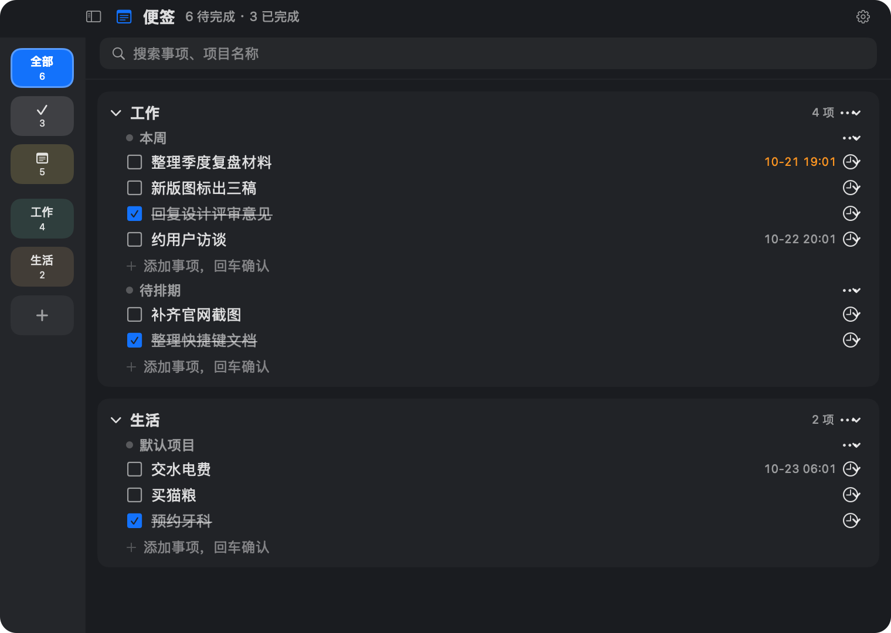
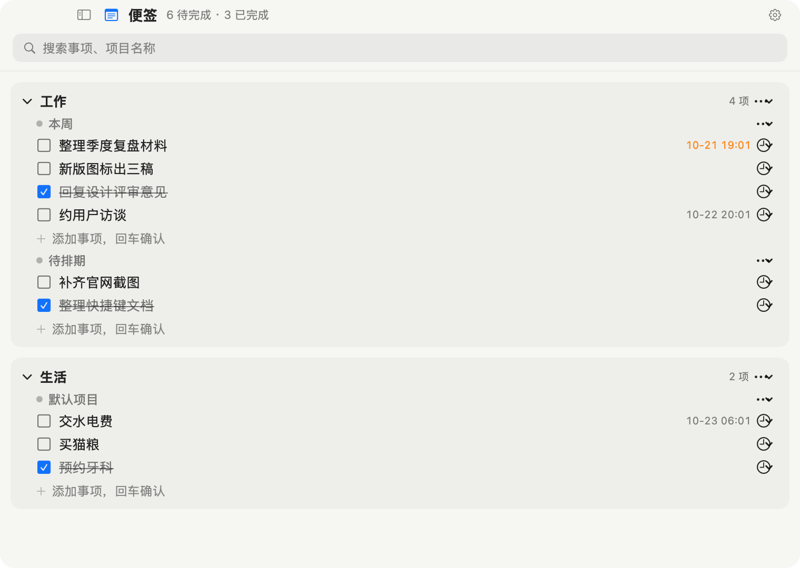

便签页。列表模式左边是按日期分组的清单、右边就地编辑；语法符号只在敲的时候显形，按 Tab 两格一级往里缩：

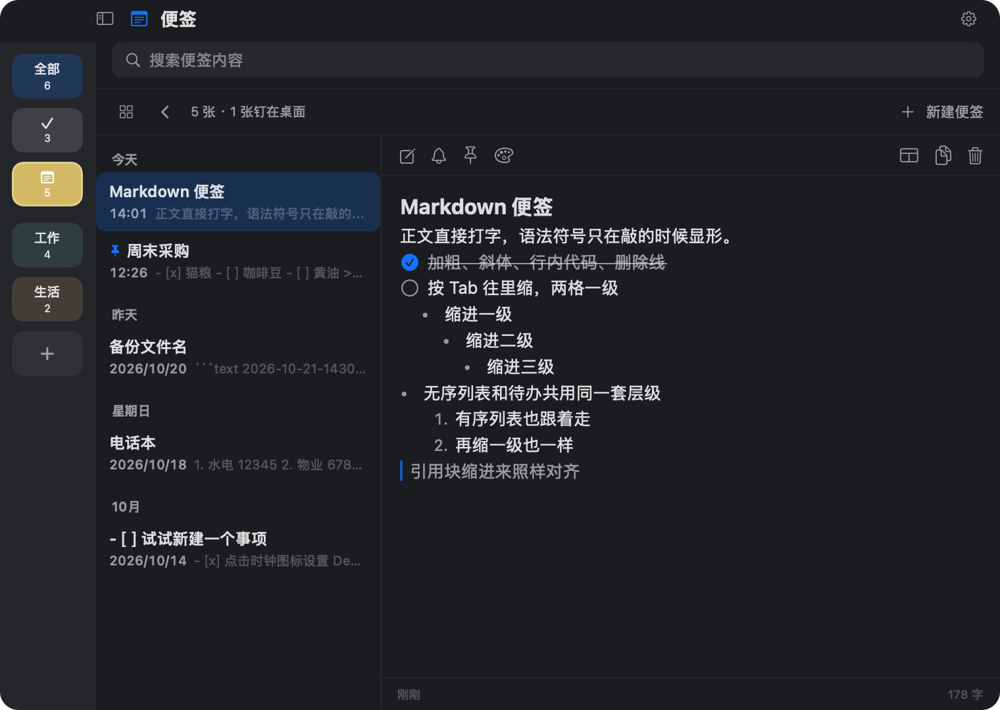

卡片墙模式，等高卡片：

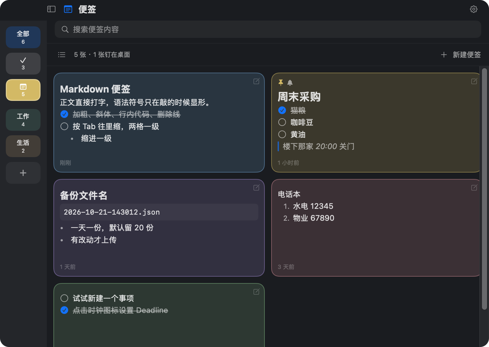

首次进入「库」可从便签和待办建立文件库，也可打开已有文件夹。

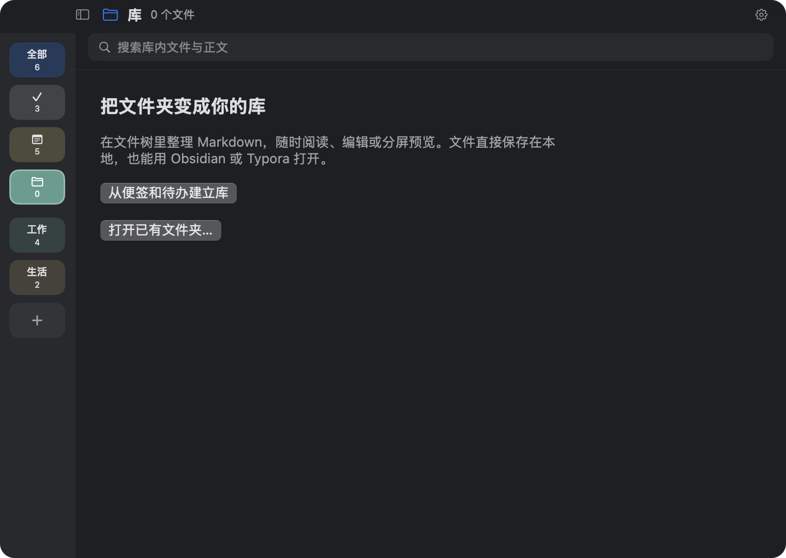

建库后，左侧文件树、右侧 Markdown 正文，支持深浅主题与阅读、编辑、分屏模式：

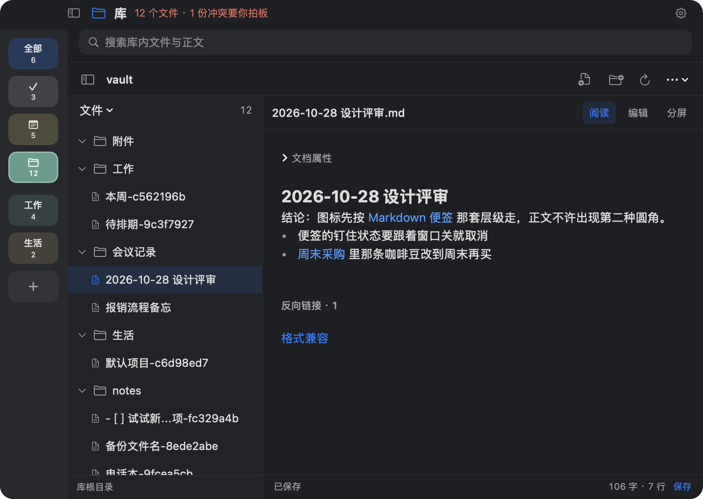
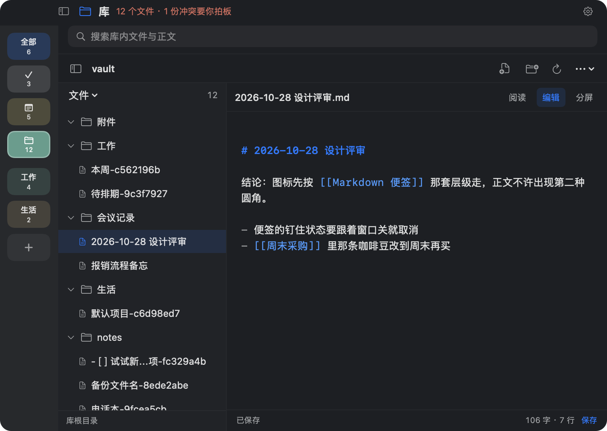
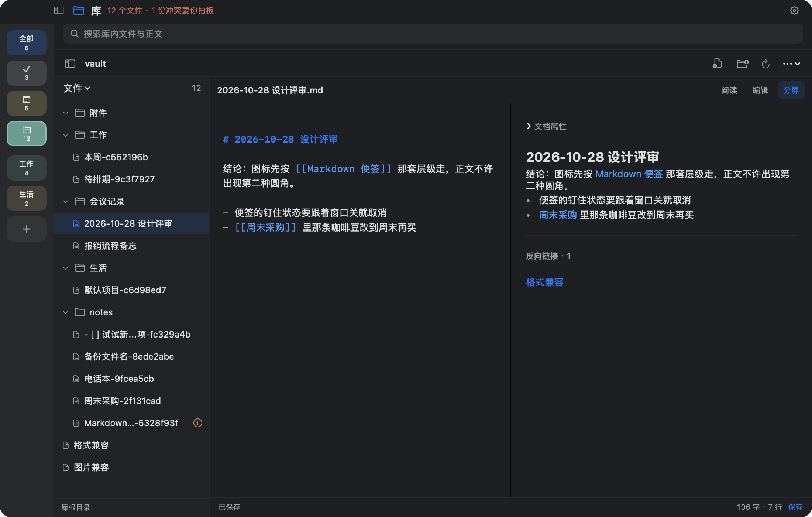
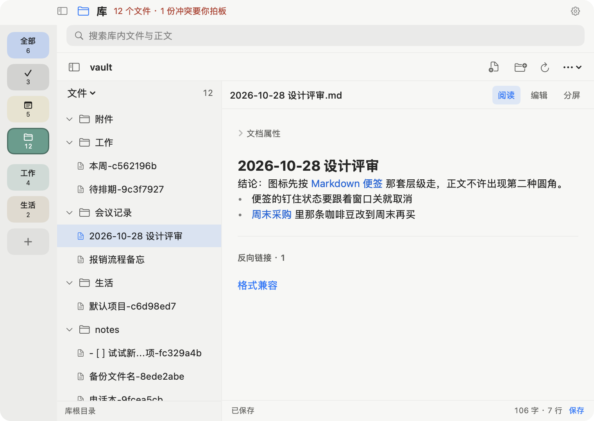

阅读视图吃 Obsidian 那一套写法：`[[双链]]` 变成能点的链接、文末列出反向链接、`![[图片.png|320]]` 和内嵌 Base64 图片直接画出来（库外的路径不读，坏掉的图片只给一句提示）。

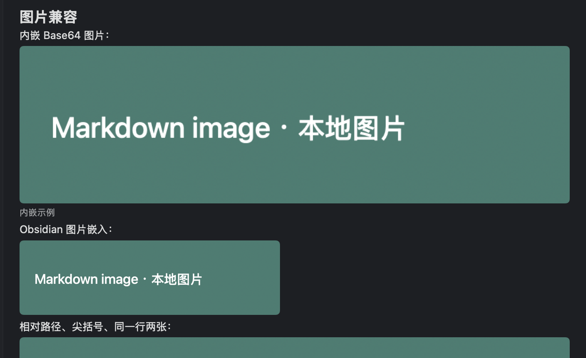

带 Mermaid、公式或 callout 的那几篇，阅读模式换成本地资源渲染：代码高亮、图表、公式、callout、脚注一次到位，页面全程不发一个网络请求。编辑和分屏仍是原生文本视图，普通代码栅栏也照原样显示——只有真需要这几样时才起网页渲染。

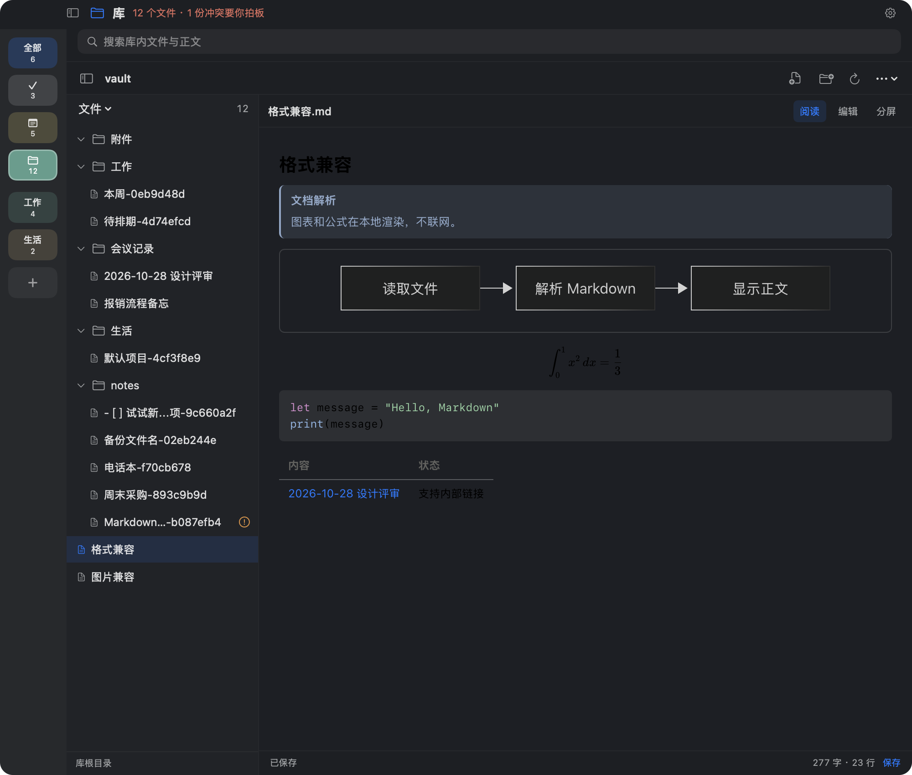

钉在桌面层的便签，和常驻桌面的待办面板：

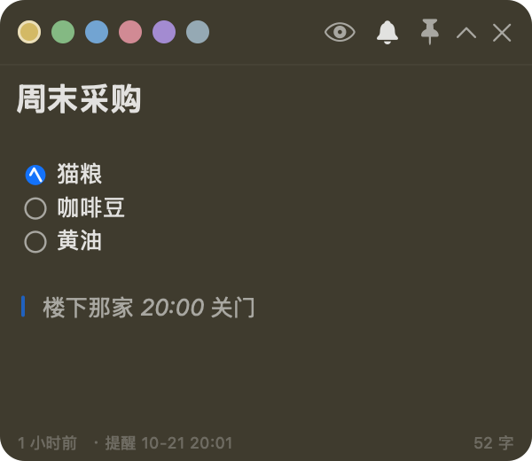
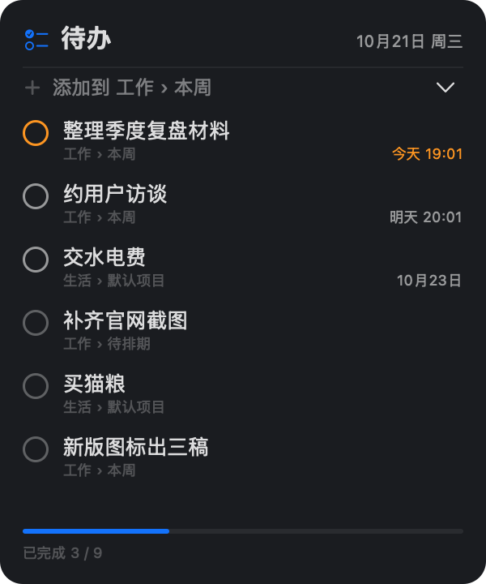

> 上面几张图全部出自 `--demo` 演示实例，内容是 `Sources/DeskNote/Demo.swift` 里写死的示例数据，跟任何人的真实笔记无关。

## 构建

```bash
git clone https://github.com/TingFeng121/DeskNoteMac.git
cd DeskNote
./build-app.sh
open build/桌面便签.app
```

`build-app.sh` 会分别编译 arm64 与 x86_64、`lipo` 成通用二进制、拼出 `.app` 并签名。只想快速验证编译：

```bash
swift build -c release
```

### 演示实例与出图

不想拿自己的数据试界面，或者要重跑 README 里那几张截图：

```bash
# 演示：数据文件指到临时目录、偏好走独立 suite，钥匙串 / 系统通知 / 全局热键 / 触发角 / 备份一概不碰
./build/桌面便签.app/Contents/MacOS/DeskNote --demo

# 出图：把各界面离屏渲染成 PNG 后退出，窗口一次都不会上屏
./build/桌面便签.app/Contents/MacOS/DeskNote --demo --shots /tmp/shots
```

示例数据写死在 `Sources/DeskNote/Demo.swift` 的 `DemoData.board()`，改完重跑一遍命令就是新图。

### 关于签名

`build-app.sh` 默认用一张本机自签证书 `DeskNote Local` 签名，并把 designated requirement 钉成「同一张证书 + 同一个 bundle id」。这一步是为了**钥匙串不再反复问密码**：ad-hoc 签名每次构建 cdhash 都变，写进钥匙串的应用密码条目就再也认不回来，于是每次重编都要重新授权一次。

第一次构建前先跑一次：

```bash
./Tools/make-signing-identity.sh
```

它会生成一张自签代码签名证书并导入登录钥匙串（私钥不落盘，中间的 PEM/P12 用完即删）。确实只想临时试一下，可以设 `DESKNOTE_ALLOW_ADHOC=1` 走 ad-hoc 签名。

## 数据与隐私

- 所有数据都在 `~/Library/Application Support/DeskNote/data.json`，纯文本 JSON，没有数据库、没有云端账号体系
- 建过库之后，便签和待办板另外落成 `<支持目录>/vault/` 里的一堆普通 .md：`notes/<首行>-<id8>.md` 一张便签，`<类别>/<项目>-<id8>.md` 一块待办板。`data.json` 不删，退成缓存——库出任何问题，它都还是完整的一份
- 库里那个 `.desknote/` 是 DeskNote 自己的本地状态：`state.json` 是同步基线（丢了只是退化成「这份文件第一次见，以磁盘为准」，不会因此丢内容），`trash/` 是在 DeskNote 里被删掉的那些文件。整个目录以点开头，Obsidian 默认不索引它
- 在 DeskNote 里删掉的便签，文件先进 `.desknote/trash/`。库目录常常挂在 iCloud 或网盘上，直接抹掉等于跨设备比谁手快
- WebDAV 的应用密码只存在登录钥匙串里（service `local.desknote.app`，account `webdav`），不会进 `UserDefaults`，也不会写进日志
- 除了你自己在设置里填的网盘地址，App 不发起任何网络请求。阅读模式里那个网页读者只从磁盘加载随包资源，库内图片走自定义 scheme 递字节，`connect-src 'none'` 钉在页面里——正文写的外链图片拿不到一次响应

## 目录结构

```
Package.swift              SwiftPM 描述（macOS 14+，Swift 5 语言模式）
Sources/DeskNote/
  main.swift               入口
  AppDelegate.swift        菜单、状态栏、各开关的落地
  Store.swift              数据层：读盘、防抖存盘、撤销点
  Model.swift              数据模型（Codable）
  AppSettings.swift        设置项（UserDefaults + 变更通知）
  WebDAV.swift             钥匙串读写、备份与自动上传
  Windows.swift            主窗口 / 设置窗口
  StickyWindow.swift       便签浮窗与窗口管理
  PanelView.swift          桌面待办面板
  RootView.swift           主窗口侧栏 + 页面切换
  SidebarView.swift        类别栏
  NotesBrowserView.swift   便签页（列表模式）
  NotesWallView.swift      便签页（卡片墙）
  SettingsView.swift       设置页
  MarkdownEditor.swift     编辑器（NSTextView 封装）
  MarkdownText.swift       只读渲染
  Vault.swift              库的文件层：目录布局、frontmatter、便签与待办板往返、[[链接]]
  VaultSync.swift          双向同步引擎：三方比对、冲突副本、回收站（只有 Foundation，能脱离界面测）
  VaultWatcher.swift       FSEvents：外部编辑器存一次盘，这边就收一次
  Library.swift            库索引：过滤口径、行集、计数、反向链接
  LibraryScan.swift        增量扫描：按 stat 决定读不读，行上只留前 32 KB（只有 Foundation）
  LibrarySearch.swift      「搜正文深处」：后台分块流式读全文，可取消（只有 Foundation）
  FileStamp.swift          一个文件的 stat 戳：用 O(1) 换掉 O(文件大小) 的那次重读
  LibraryTreeIndex.swift   文件树索引：先序区间，折叠一个目录跳过整棵子树
  LibraryTreeState.swift   折叠与选中状态，独立于正文那半边
  LibraryFileTree.swift    文件树视图：折叠目录不再连累重解析
  LibraryWorkspace.swift   库工作区：文件树、阅读/编辑/分屏、新建与重命名
  LibraryDocument.swift    文档会话：自动保存、外部改动保护、大文档后台装载
  LibraryFiles.swift       文件读写：元数据原样保留、冲突副本
  LibrarySourceEditor.swift 原生 Markdown 源码编辑
  LibraryReader.swift      原生 Markdown 阅读与内部链接
  ReaderParse.swift        阅读层的纯解析：散文 / 表 / 图（不带 SwiftUI 与 AppKit）
  ReaderCache.swift        解析缓存：内容哈希 → 解析结果，NSCache 按字节计成本
  LibraryRichReader.swift  网页读者：Mermaid、公式、代码高亮、callout、脚注，只读本地资源
  HotCorner.swift          触发角探针 + 全局热键
  Notifier.swift           系统通知
  Demo.swift               --demo 演示实例：示例数据 + 离屏出图 + 真机自检
  Helpers.swift            布局常量、日期格式、配色、登录项
MarkdownRenderer/          随包携带的本地渲染资源：markdown-it、DOMPurify、highlight.js、KaTeX、mermaid
                           VERSIONS.json 记每个文件的 SHA-256，licenses/ 与 NOTICE.md 跟着
Resources/                 图标（AppIcon-1024.png 与生成的 .icns）
Tools/make-iconset.swift   从 PNG 生成 icns
Tools/make-signing-identity.sh  本机自签代码签名身份
Tools/vault-tests/run.sh   五层回归：vault / sync / library / tree / reader（swiftc 直接编，不进 Package.swift）
build-app.sh               出 .app
```

## 许可

MIT，见 [LICENSE](LICENSE)。
