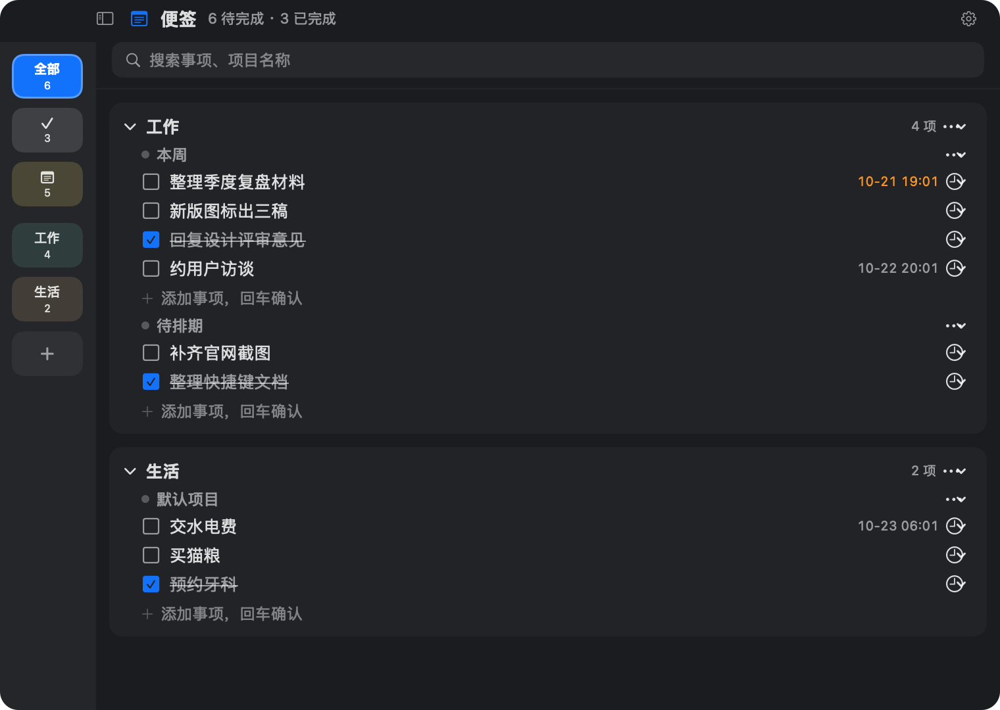
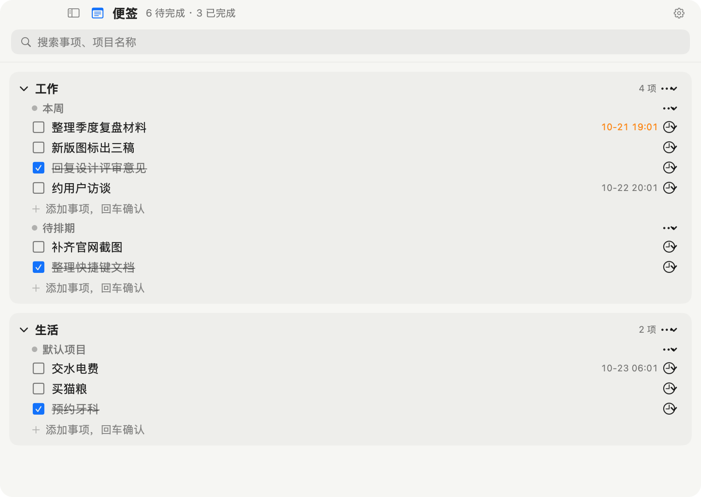
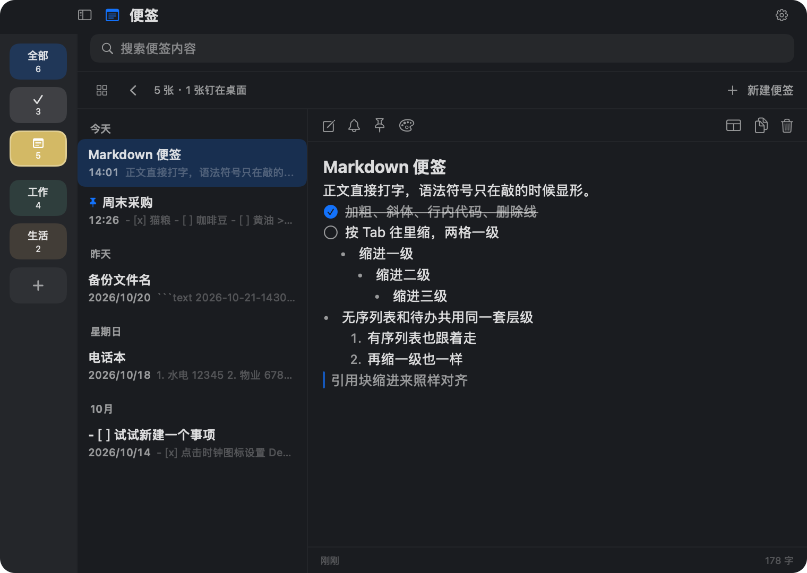
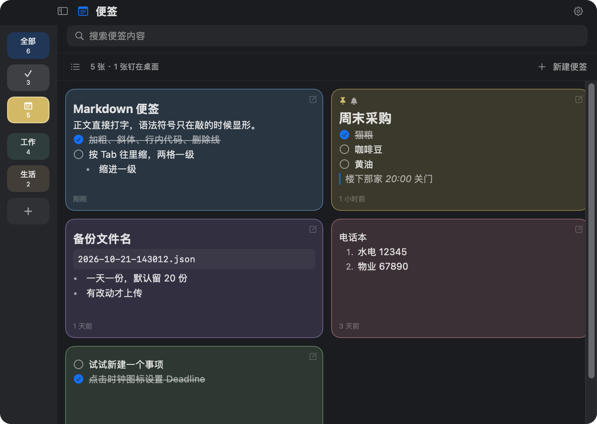
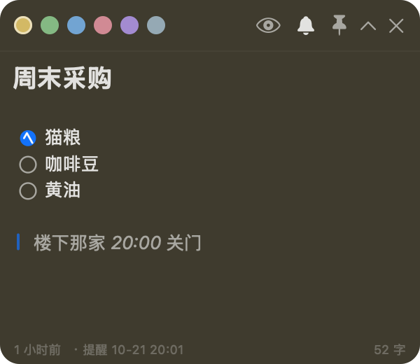
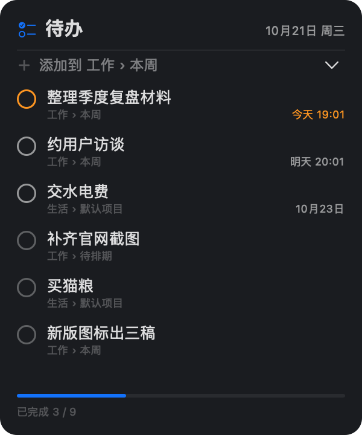

# 桌面便签 / DeskNote

一个 macOS 原生的桌面便签与待办工具：便签可以钉在桌面上，待办按「类别 → 项目 → 事项」三层组织，数据是一个本地 JSON 文件，可选地把整个文件备份到任意 WebDAV 网盘。

用 Swift + AppKit/SwiftUI 写成，SwiftPM 构建，**不需要 Xcode 工程**（装了 Command Line Tools 就能编译）。要求 macOS 14 及以上。

## 功能

- **便签浮窗**：钉在桌面（落在桌面图标层，跟随所有 Space）、折叠成一条工具栏、拖边框调高度、红绿灯按钮（关闭即隐藏，关掉钉住的便签等于取消钉住）
- **主窗口两种视图**：列表模式（日期分组列表｜正文，中间栏可收起）和卡片墙模式（等高卡片）
- **待办三层结构** + 桌面待办面板（常驻桌面层，可直接快速添加）
- **Markdown 轻量编辑**：标题、列表、勾选框、加粗，边写边渲染
- **Deadline 与系统通知**：每个 Deadline 到点提醒一次，不提前、不补发
- **WebDAV 备份**：兼容坚果云等。有改动后静置 1 分钟自动上传一份带时间戳的完整副本，保留最近 N 份，可从列表里选一份覆盖本地（本地这份会先留成 `data.json.bak`）
- **全局热键 ⌥⌘N**：不在前台也能新建便签（Carbon 注册，不需要任何权限）
- **触发角新建便签**：鼠标甩到屏幕四角之一即弹一张便签（需要辅助功能权限，默认关闭）
- **开机自动启动**（`SMAppService` 登录项）
- 深/浅主题、窗口透明度、字号可调

## 界面

事项板，深色与浅色两套主题：




便签页。列表模式左边是按日期分组的清单、右边就地编辑；语法符号只在敲的时候显形，按 Tab 两格一级往里缩：



卡片墙模式，等高卡片：



钉在桌面层的便签，和常驻桌面的待办面板：




> 上面几张图全部出自 `--demo` 演示实例，内容是 `Sources/DeskNote/Demo.swift` 里写死的示例数据，跟任何人的真实笔记无关。

## 构建

```bash
git clone https://github.com/TingFeng121/DeskNoteMac.git
cd DeskNote
./build-app.sh
open build/桌面便签.app
```

`build-app.sh` 会分别编译 arm64 与 x86_64、`lipo` 成通用二进制、拼出 `.app` 并签名。只想快速验证编译：

```bash
swift build -c release
```

### 演示实例与出图

不想拿自己的数据试界面，或者要重跑 README 里那几张截图：

```bash
# 演示：数据文件指到临时目录、偏好走独立 suite，钥匙串 / 系统通知 / 全局热键 / 触发角 / 备份一概不碰
./build/桌面便签.app/Contents/MacOS/DeskNote --demo

# 出图：把各界面离屏渲染成 PNG 后退出，窗口一次都不会上屏
./build/桌面便签.app/Contents/MacOS/DeskNote --demo --shots /tmp/shots
```

示例数据写死在 `Sources/DeskNote/Demo.swift` 的 `DemoData.board()`，改完重跑一遍命令就是新图。

### 关于签名

`build-app.sh` 默认用一张本机自签证书 `DeskNote Local` 签名，并把 designated requirement 钉成「同一张证书 + 同一个 bundle id」。这一步是为了**钥匙串不再反复问密码**：ad-hoc 签名每次构建 cdhash 都变，写进钥匙串的应用密码条目就再也认不回来，于是每次重编都要重新授权一次。

第一次构建前先跑一次：

```bash
./Tools/make-signing-identity.sh
```

它会生成一张自签代码签名证书并导入登录钥匙串（私钥不落盘，中间的 PEM/P12 用完即删）。确实只想临时试一下，可以设 `DESKNOTE_ALLOW_ADHOC=1` 走 ad-hoc 签名。

## 数据与隐私

- 所有数据都在 `~/Library/Application Support/DeskNote/data.json`，纯文本 JSON，没有数据库、没有云端账号体系
- WebDAV 的应用密码只存在登录钥匙串里（service `local.desknote.app`，account `webdav`），不会进 `UserDefaults`，也不会写进日志
- 除了你自己在设置里填的网盘地址，App 不发起任何网络请求

## 目录结构

```
Package.swift              SwiftPM 描述（macOS 14+，Swift 5 语言模式）
Sources/DeskNote/
  main.swift               入口
  AppDelegate.swift        菜单、状态栏、各开关的落地
  Store.swift              数据层：读盘、防抖存盘、撤销点
  Model.swift              数据模型（Codable）
  AppSettings.swift        设置项（UserDefaults + 变更通知）
  WebDAV.swift             钥匙串读写、备份与自动上传
  Windows.swift            主窗口 / 设置窗口
  StickyWindow.swift       便签浮窗与窗口管理
  PanelView.swift          桌面待办面板
  RootView.swift           主窗口侧栏 + 页面切换
  SidebarView.swift        类别栏
  NotesBrowserView.swift   便签页（列表模式）
  NotesWallView.swift      便签页（卡片墙）
  SettingsView.swift       设置页
  MarkdownEditor.swift     编辑器（NSTextView 封装）
  MarkdownText.swift       只读渲染
  HotCorner.swift          触发角探针 + 全局热键
  Notifier.swift           系统通知
  Demo.swift               --demo 演示实例：示例数据 + 离屏出图
  Helpers.swift            布局常量、日期格式、配色、登录项
Resources/                 图标（AppIcon-1024.png 与生成的 .icns）
Tools/make-iconset.swift   从 PNG 生成 icns
Tools/make-signing-identity.sh  本机自签代码签名身份
build-app.sh               出 .app
```

## 许可

MIT，见 [LICENSE](LICENSE)。
